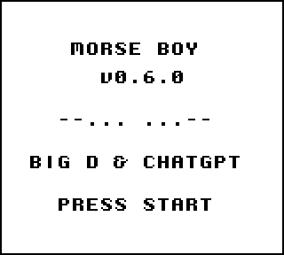
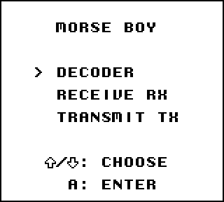
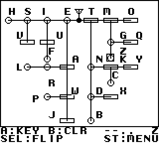
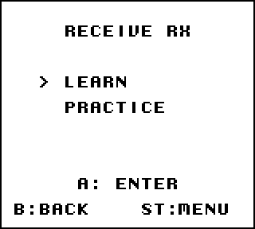
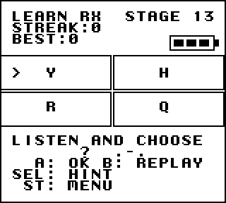
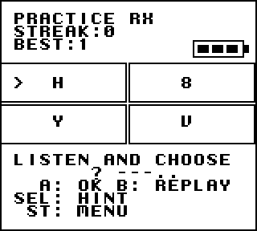
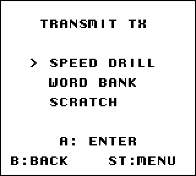
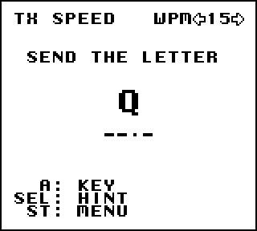
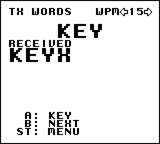
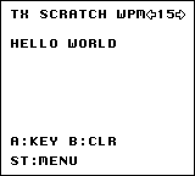

# Morse Boy

A homebrew Game Boy Morse-code trainer.

Created by dansciurus (Big D), with ChatGPT assistance.

**v0.6.0** includes the Game Boy ROM and user materials. Development source
and Git history remain private.

## Community hardware testing

Help test Morse Boy with your keying instrument, original Game Boy hardware,
flash cartridge or handheld. Please report the device and cartridge/interface,
emulator/core and software version where applicable, mode, WPM, input mapping
and results. Check keying responsiveness, transcription, clear/menu controls
and audio continuity.

A computer-connected Morse key may be usable with an interface that maps its
input to emulator buttons, with some configuration. This setup has not been
verified; reports of working mappings and timing are welcome. Original-hardware
compatibility remains unverified.

## Features

- **Decoder:** a live Morse chart with two orientations, keying tone, sequence
  and decoded-character display. Its fixed timing is independent of TX WPM.
- **Receive RX:** Learn uses 13 cumulative, freely selectable stages; Practice
  includes all 26 letters and ten digits. Choose an answer, replay, request a
  free hint, and track streaks with three battery-style lives.
- **Transmit TX:** Speed Drill gives randomized letter targets and optional
  hints. Word Bank offers 64 targets and faithfully records your input.
  Scratch is a free-transmission page with real word spaces and 144 cells.
- TX modes share 05–99 WPM controls, starting at 15 WPM on a fresh session.
- A startup soundtrack accompanies the splash screen and main menu.

## Screenshot gallery

Actual approved-ROM captures in gameplay order, enlarged exactly 2× with
nearest-neighbor scaling to preserve the original pixels. These are emulator
captures, not photographs of original hardware. RX examples show an optional
hint; the Words example retains an intentional transmitted mistake.

**00 — Splash screen**

**01 — Main Menu**

**02 — Decoder**

**02b — Decoder, flipped**

**03 — RX Menu**

**04 — RX Learn**

**05 — RX Practice**

**06 — TX Menu**

**07 — TX Speed**

**08 — TX Words**

**09 — TX Scratch**

## Get started

1. Extract this ZIP and load **MorseBoy.gb** in a Game Boy emulator.
2. Map ordinary Game Boy inputs: D-pad, A, B, SELECT and START. Disable turbo,
   auto-fire and fast-forward while practicing timed input.
3. Press START at the splash. Use UP/DOWN and A in the main menu:
   **DECODER → RECEIVE RX → TRANSMIT TX**.
4. START returns from an activity to the main menu. See [the controls and
   emulator guide](GUIDE.md) for every mode and the verified handheld remap.

## Compatibility and testing

Original Nintendo Game Boy is the design target. Human development-level
acceptance was completed in **BGB on Windows**; automated tests use **PyBoy**.
An **EmuELEC / RetroArch / Gambatte** game-specific R2 remap was verified,
including persistence after relaunch. That check does not certify every
handheld or high-speed timing on that platform. Exact platform versions and
handheld model have not been documented for this package.

Original Game Boy hardware, flash cartridges, other console variants and
other emulator/device combinations remain unverified. No original-hardware,
maximum-speed or subjective speaker-quality certification is claimed.

## Limitations

There is no battery-backed saving. RX best streak is session-only. Decoder
covers the letter chart and uses fixed timing; TX supports letters and digits,
not punctuation. Invalid TX sequences appear as `?`.
Word Bank retains 36 large received characters, omits spaces between them,
and advances only with B. Scratch has 144 cells, no scrolling or editing,
and stops appending at FULL until B clears it. Long words may split at a line.
Requested WPM is displayed immediately; a partial character keeps its previous
timing until the next character boundary. Mode entry and word changes may
include a brief intentional blank/progressive transition.

## Feedback

Before reporting a problem, record the mode, WPM, buttons used, expected and
actual result, and emulator/device version. Include a screenshot or a short
clip if useful. Do not include private account details. Include those details when sharing a test report with the creator.

See [release notes](RELEASE-NOTES.md), [change history](CHANGELOG.md),
[build identity](BUILD-INFO.txt), [distribution status](DISTRIBUTION-STATUS.txt)
and [third-party notices](THIRD-PARTY-NOTICES.md). The source code remains private. See the approved [distribution terms](DISTRIBUTION-TERMS.txt).

## Credits and sharing

Created by dansciurus (Big D), with ChatGPT assistance.

Morse Boy is free to download and play. The original, unmodified ROM may be shared freely for noncommercial purposes, provided creator attribution is retained. Commercial redistribution, distribution of modified versions, and claiming authorship are not permitted without the creator's permission. The source code remains private. Preserve all applicable third-party license notices.

